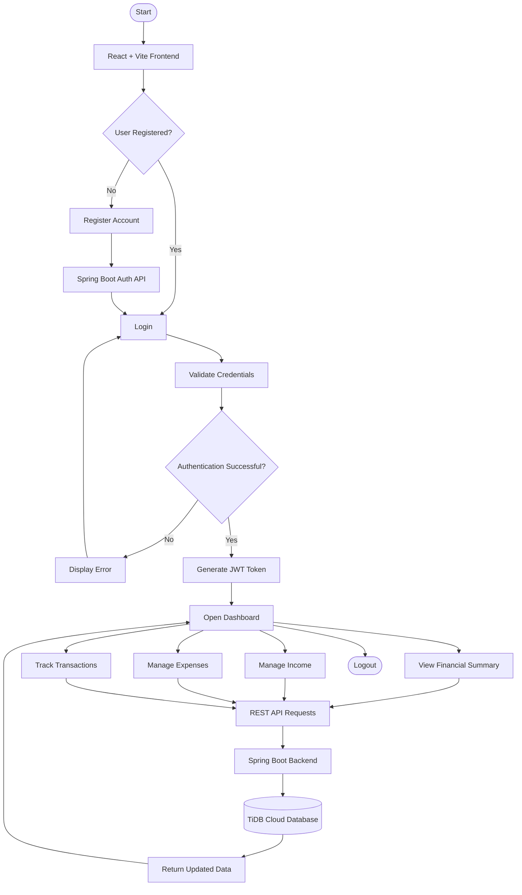

# 💰 Personal Finance Dashboard

A Full-Stack Personal Finance Management Application built to help users manage their income, expenses, and financial activities through a simple and interactive dashboard.

## 🚀 Project Overview

Personal Finance Dashboard is a web-based application designed to make personal financial management easier and more organized.

Users can securely register and log in, monitor their financial activities, and manage their financial information through an interactive dashboard.

The application uses React for the frontend, Spring Boot for backend services, JWT for authentication, and TiDB Cloud for database management.

## ✨ Key Features

- User Registration and Login
- JWT-Based Authentication
- Secure Password Encryption
- Interactive Financial Dashboard
- Income Management
- Expense Management
- Transaction Tracking
- Financial Summary
- REST API Integration
- Cloud Database Connectivity
- Responsive User Interface

## 🛠️ Tech Stack

### Frontend
- React.js
- Vite
- JavaScript
- HTML5
- CSS3

### Backend
- Java
- Spring Boot
- Spring Security
- Spring Data JPA
- REST APIs
- JWT Authentication

### Database
- TiDB Cloud
- MySQL

### Deployment & Tools
- Git & GitHub
- Vercel – Frontend Deployment
- Render – Backend Deployment
- Postman – API Testing

## 🏗️ Project Architecture

The application follows a full-stack architecture where the frontend communicates with the backend through REST APIs.



## 📂 Project Structure

```text
personal-finance-dashboard/
│
├── backend/
│   ├── src/
│   │   └── main/
│   │       ├── java/
│   │       │   └── com/personalfinance/finance/
│   │       │       ├── config/
│   │       │       ├── controller/
│   │       │       ├── entity/
│   │       │       ├── repository/
│   │       │       ├── security/
│   │       │       └── service/
│   │       │
│   │       └── resources/
│   │           └── application.properties
│   │
│   └── Dockerfile
│
├── src/
│   ├── assets/
│   ├── components/
│   ├── pages/
│   ├── services/
│   └── App.jsx
│
├── public/
├── package.json
└── README.md
```

*Note: The structure above represents the main application layers; individual filenames may vary.*

## 🔐 Authentication & Security

- JWT-based authentication.
- Password encryption using BCrypt.
- Spring Security for endpoint protection.
- Protected API endpoints.
- CORS configuration for frontend-backend communication.

## ⚙️ Installation & Setup

### 1. Clone the Repository

```bash
git clone https://github.com/mohitetanvi06-ai/personal-finance-dashboard.git
```

### 2. Navigate to the Project

```bash
cd personal-finance-dashboard
```

### 3. Install Frontend Dependencies

```bash
npm install
```

### 4. Configure Environment Variables

Create a `.env` file in the frontend root directory:

```env
VITE_API_BASE_URL=http://localhost:8080/api
```

### 5. Start Frontend

```bash
npm run dev
```

### 6. Configure Backend

Configure the following environment variables for the Spring Boot backend:

```env
DB_URL=your_database_url
DB_USERNAME=your_database_username
DB_PASSWORD=your_database_password
JWT_SECRET=your_secure_jwt_secret
```

### 7. Run Backend

Open the backend project and run the Spring Boot application.

The backend runs locally on:

```text
http://localhost:8080
```

## 🌐 Live Deployment

- **Frontend:** [Personal Finance Dashboard](https://personal-finance-dashboard-peach.vercel.app/)
- **Backend:** Hosted on Render
- **Database:** TiDB Cloud

## 🎯 Project Goals

- Simplify personal financial management.
- Provide secure user authentication.
- Organize income and expense information.
- Build a responsive full-stack web application.
- Understand real-world frontend and backend integration.
- Implement cloud deployment and database connectivity.

## 👩‍💻 Author

**Tanvi Mohite**

- GitHub: [mohitetanvi06-ai](https://github.com/mohitetanvi06-ai)

---

⭐ If you find this project useful, consider giving it a star!

**Built with ❤️ using React, Spring Boot, and TiDB Cloud.**
